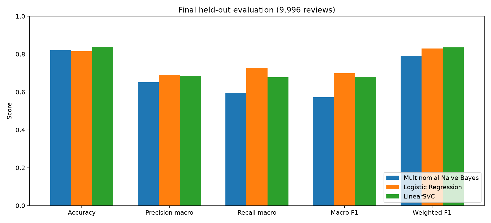
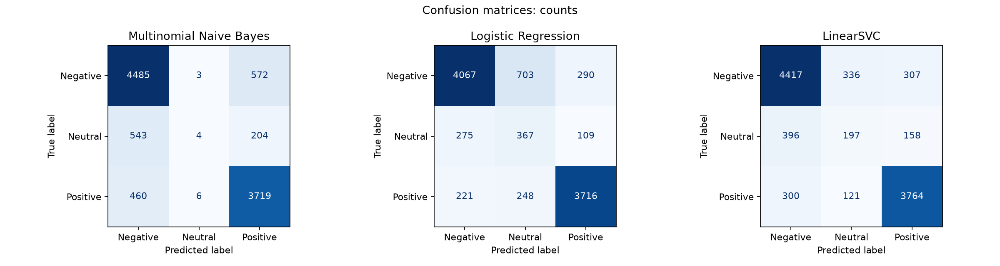
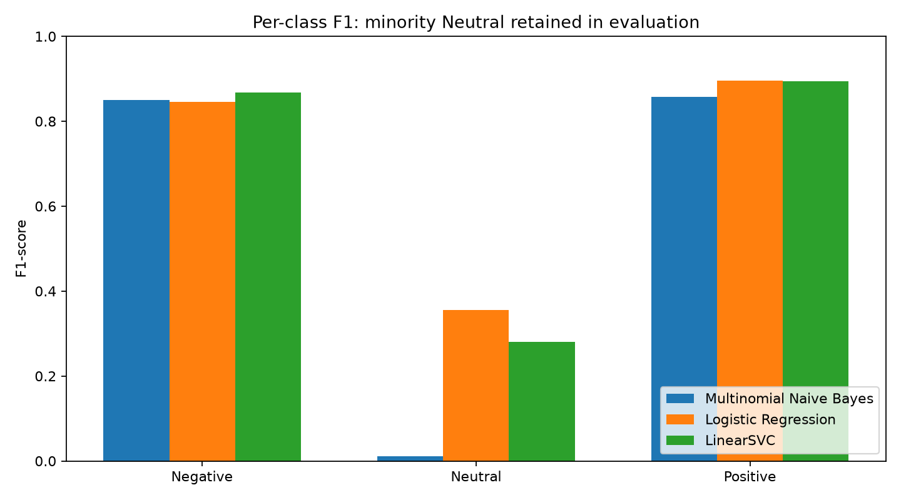

# Hasil Phase 4–5: klasifikasi sentimen GTA VI

Evaluasi aktual terhadap 9,996 ulasan test dari artifact grouped_v1. Split dan TF-IDF tidak dibuat ulang. Tidak ada tuning atau pemilihan konfigurasi menggunakan test.

Konfigurasi dibekukan di model_plan.json sebelum training. PRD.md menetapkan algoritma, sedangkan hyperparameter baseline merupakan keputusan implementasi. LR/SVM menggunakan class_weight=balanced; Naive Bayes memakai prior kelas empiris training.

Precision dan Recall pada tabel utama memakai macro average. Seluruh skor ditampilkan dalam persen. Metrik dengan pembagi nol diberi nilai 0 (zero_division=0).

| Model | Accuracy | Precision macro | Recall macro | Macro F1 | Weighted F1 |
|---|---:|---:|---:|---:|---:|
| Logistic Regression | 81.53 | 69.09 | 72.68 | 69.85 | 82.94 |
| LinearSVC | 83.81 | 68.50 | 67.82 | 68.12 | 83.52 |
| Multinomial Naive Bayes | 82.11 | 65.08 | 59.34 | 57.26 | 79.00 |

| Model | Kelas | Precision | Recall | F1 | Support |
|---|---|---:|---:|---:|---:|
| Logistic Regression | Negative | 89.13 | 80.38 | 84.53 | 5060 |
| Logistic Regression | Neutral | 27.85 | 48.87 | 35.48 | 751 |
| Logistic Regression | Positive | 90.30 | 88.79 | 89.54 | 4185 |
| LinearSVC | Negative | 86.39 | 87.29 | 86.84 | 5060 |
| LinearSVC | Neutral | 30.12 | 26.23 | 28.04 | 751 |
| LinearSVC | Positive | 89.00 | 89.94 | 89.47 | 4185 |
| Multinomial Naive Bayes | Negative | 81.72 | 88.64 | 85.04 | 5060 |
| Multinomial Naive Bayes | Neutral | 30.77 | 0.53 | 1.05 | 751 |
| Multinomial Naive Bayes | Positive | 82.74 | 88.86 | 85.69 | 4185 |

Peringkat pertama berdasarkan Macro F1 pada test ini: **Logistic Regression**. Peringkat ini tidak membuktikan signifikansi statistik dan tidak digunakan untuk tuning ulang.

Baseline kelas mayoritas dipilih dari training: Negative. Accuracy=50.62%; Macro F1=22.41%.

Seluruh 26 vektor test kosong tetap masuk evaluasi. Rincian subgroup tersedia pada evaluation.json.

## Analisis kesalahan

- Logistic Regression: 1846 kesalahan. Pasangan terbanyak: Negative → Neutral: 703; Negative → Positive: 290; Neutral → Negative: 275.
- LinearSVC: 1618 kesalahan. Pasangan terbanyak: Neutral → Negative: 396; Negative → Neutral: 336; Negative → Positive: 307.
- Multinomial Naive Bayes: 1788 kesalahan. Pasangan terbanyak: Negative → Positive: 572; Neutral → Negative: 543; Positive → Negative: 460.

Kesalahan di atas merupakan pola kebingungan label, bukan diagnosis penyebab bahasa/sarkasme yang belum dianotasi. Identitas setiap kesalahan tersedia di misclassifications.csv.

## Artifact dan verifikasi

Model Joblib dan training_manifest.json berada di models/grouped_v1. Prediksi untuk setiap baris test ada di predictions.csv. Classification report, confusion matrix CSV, grafik, dan metrik agregat tersimpan pada direktori laporan ini. evaluation_verification.json mencatat pemuatan ulang, prediksi ulang, dan perhitungan ulang metrik dari prediksi aktual.

## Keterbatasan

- Satu held-out test; peringkat bukan bukti signifikansi statistik.
- Tidak ada tuning setelah melihat test; test tidak lagi boleh dipakai untuk tuning berikutnya.
- Label merupakan proksi rating dan bukan anotasi manusia.
- Subset deduplikasi ID dan cleaning legacy diwarisi dari eksperimen sebelumnya.
- Vektor kosong tetap dihitung; subgroup kecil tidak mewakili seluruh dataset.
- Versi/lisensi Kaggle dan semantik review_id belum terverifikasi independen.
